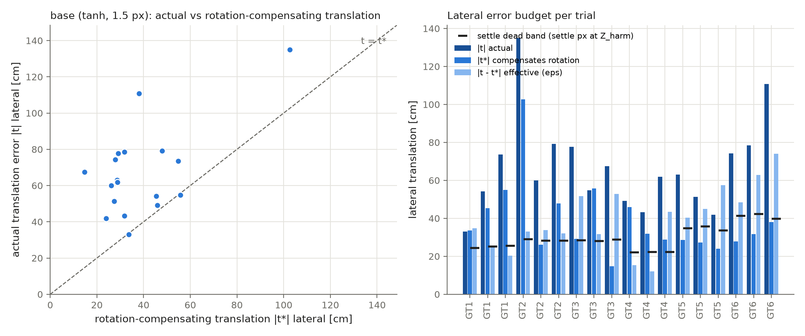
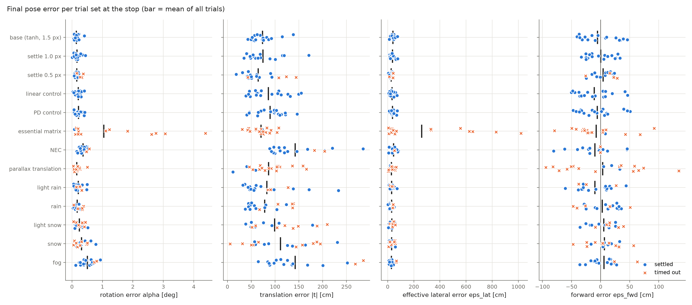
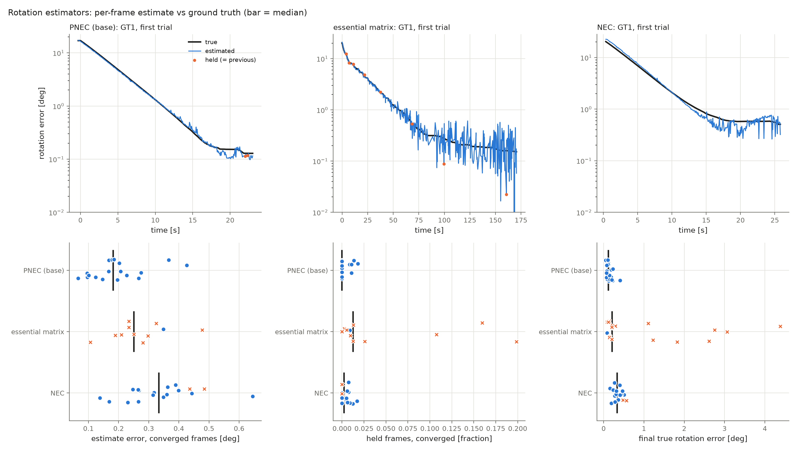
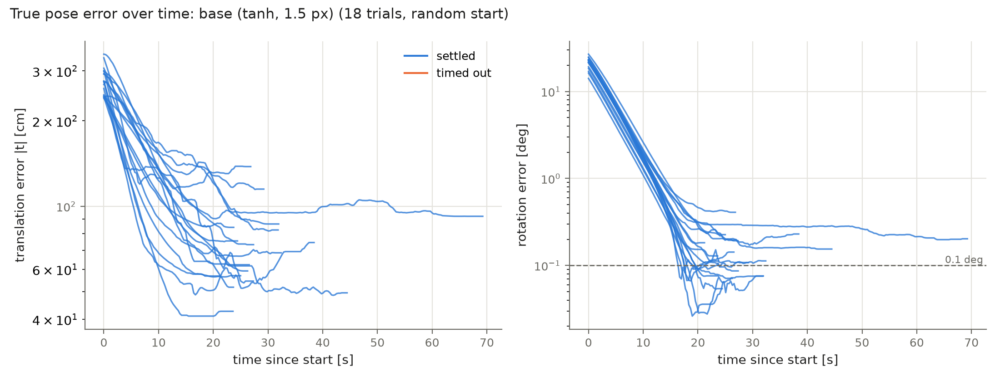
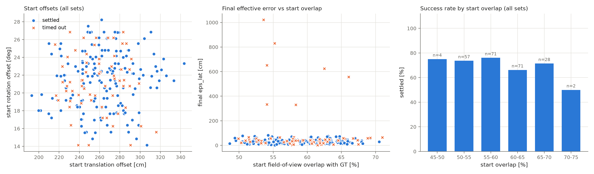

# Simulation Results: Monocular Return-to-Location Repositioning

> **Status:** simulation results (Unreal Engine). Real-drone results will be added in a later section.
> CLIP scores are computed against GT images re-captured on 2026-10-13 at the identical poses, under
> lighting that matches the evaluation runs (see [§8](#8-image-similarity-clip)).
>
> All numbers come from `analyze_final_motion.py` (outputs in `analysis/`: `results.json`,
> `trials.csv`, `summary.md`, `figures/`). Values are given as **mean ± SD (RMSE)** over trials unless
> stated otherwise.
>
> **Every statistic includes all trials.** A run stops either when the stopping criterion is met
> ("settled") or at the 180 s timeout. The timeout is a deliberate design decision, not a failure, so
> in both cases the pose at the moment the system stops is the result and is evaluated as is. The
> number of runs that stopped by the criterion is reported separately.

---

## 1. Summary

- **With PNEC or NEC the rotation converged in every trial.** All 215 trials of these
  configurations with a recorded final pose, across all weather conditions, ended with a true
  rotation error below 1°. They started 14–28° away from the target. The only trials above 1° are 7 of
  the 18 essential-matrix ablation runs (§6).
- **The translation error decreased in 231 of 233 trials.** Only one of the two exceptions is a
  weather run (fog at GT2); the other is the NEC ablation.
- **In clear conditions the method is reliable.** The base configuration (PNEC + tanh control,
  1.5 px settle threshold) met its stopping criterion in **18/18** trials, in 30.8 s on average. Its
  final pose error was:
  - rotation **0.147 ± 0.086° (RMSE 0.169°)**,
  - effective (visible) lateral position error **39.7 ± 16.5 cm (RMSE 42.8 cm)**, about
    **2 px** at the 190 m scene depth.
- **The translation error never goes to zero, and that is expected.** The controller aligns
  *images*. A residual rotation of α is best compensated in the image by a lateral translation of
  about α·Z. At the scene depth Z ≈ 190 m, 0.15° corresponds to about 40–50 cm. The part of the
  translation error that is *not* explained by this compensation is the effective error ε, and it is
  of the order of the settle threshold.
- **The method converges in every weather condition, with lower precision in bad weather.**
  Rotation error at the stop, over all trials:

  | condition | rotation error α at stop | worst trial | ε_lat | stopped by criterion |
  |---|---|---|---|---|
  | clear | 0.15 ± 0.09° | 0.41° | 40 cm | 18/18 |
  | light rain | 0.21 ± 0.13° | 0.50° | 30 cm | 15/18 |
  | rain | 0.17 ± 0.11° | 0.38° | 29 cm | 13/18 |
  | light snow | 0.25 ± 0.14° | 0.52° | 32 cm | 10/18 |
  | heavy snow | 0.32 ± 0.21° | 0.78° | 30 cm | 8/18 |
  | fog | 0.51 ± 0.23° | 0.93° | 28 cm | 15/18 |

  **Fog and heavy snow are the most difficult conditions.** In clear weather the rotation precision
  is about 0.15°. In heavy snow it is about 0.3°, and in fog about 0.5°, **within 1°** in every
  trial. The visible lateral error ε_lat stays at about 30 cm in every condition.
- **The system stops within 3 minutes in every trial.** The timeout was 180 s, well inside the
  project's 10-minute repositioning budget. Outside the essential-matrix ablation, the 50 runs
  stopped by the timeout ended with rotation errors of 0.04–0.81° and a median translation error of
  1.1 m, down from about 2.6 m at the start. Their errors are included in all statistics.
- **PNEC is the best rotation estimator.**

  | | PNEC | NEC | essential matrix |
  |---|---|---|---|
  | final rotation error | **0.15 ± 0.09°**, worst 0.41° | 0.36 ± 0.12° | 1.05 ± 1.32°, worst 4.4° |
  | per-frame estimate error (median) | **0.24°** | 0.36° | 0.40° |
  | stopped by criterion | **18/18** | 16/18 | 1/18 |

  Adding the keypoint covariances (NEC → PNEC) reduces the final rotation error by a factor of 2.4.
  The essential matrix, used frame by frame without any smoothing, gives a rotation estimate that
  jitters about 3× more than PNEC's near convergence (0.36° vs 0.12° per frame). It meets the
  stopping criterion in only 1 of 18 runs and ends with more than 1° of rotation error in 7 of 18
  (see [§6](#6-rotation-estimator-pnec-vs-nec-vs-essential-matrix)).
- **The final view matches the target.** CLIP similarity between the End image and the GT image
  is **0.976** in clear weather (0.954–0.992), up from 0.908 at the start (§8).

---

## 2. Experimental setup

### 2.1 Scenario

A target image is captured at a reference pose (**GT1–GT6**, six positions in the UE map). For each
trial the drone starts from a random pose near the target and must return to the reference pose
using only the monocular camera image and the stored target image.

| | value |
|---|---|
| Start offset, translation | 1.9–3.4 m (median ≈ 2.6 m) |
| Start offset, rotation | 14–28° |
| Start field-of-view overlap with the target view | 49–71 % (mean ≈ 59 %) |
| Trials per configuration | 18 (6 GT positions × 3 repetitions) |
| Stopping criterion | image translation error < settle threshold (1.5 px in the base configuration) and estimated rotation error < 0.1°, held for 2 s |
| Timeout | 180 s. A deliberate stop; the pose at the timeout is evaluated like any other stop. |
| Camera | 1920 × 1080, 90° horizontal FOV, f = 960 px |
| Scene depth at the matched keypoints (harmonic mean) | 140–230 m |

The field-of-view overlap is the fraction of target-image pixels that are inside the start camera's
image. It is computed from the GT depth map, with sky pixels treated as infinitely far away.

### 2.2 Configurations

| set | rotation estimator | control | translation source | settle threshold | weather |
|---|---|---|---|---|---|
| **base** | PNEC | tanh | flow | 1.5 px | clear |
| light rain / rain / light snow / snow / fog | PNEC | tanh | flow | 1.5 px | as named |
| settle 1.0 px / 0.5 px | PNEC | tanh | flow | 1.0 / 0.5 px | clear |
| linear control / PD control | PNEC | linear / PD | flow | 1.5 px | clear |
| essential matrix ² / NEC | E / NEC | tanh | flow | 1.5 px | clear |

² Recorded on 2026-10-13. The essential matrix is estimated every frame and used directly, with no
reuse of the previous estimate when it is ill-conditioned (see §6).
| parallax translation | PNEC | tanh | parallax | 1.5 px | clear |

### 2.3 Ground truth and metrics

For every GT position and every trial, the simulator exports the exact camera pose (`meta.json`) and,
for the GT views, a dense depth map. All pose errors are computed between the true final camera pose
and the GT camera pose. They are expressed in the GT camera frame: x right, y down, z forward.

| symbol | meaning |
|---|---|
| **α** | true final rotation error (angle of the relative rotation), deg |
| **\|t\|** | true final translation error, cm |
| **t\*** | translation that best re-aligns the GT scene in the image for the remaining rotation error α. Computed by least squares over the matched keypoints, using GT depth with the rotation held fixed. For a scene at depth Z, \|t\*\| ≈ α·Z. |
| **ε = t − t\*** | **effective translation error**: the part of the translation error that is *not* compensating the rotation |
| **ε_lat** | component of ε perpendicular to the optical axis. This is what the image can see. |
| **ε_fwd** | component of ε along the optical axis, signed. A monocular camera observes this direction only weakly. |
| **dead band** | settle threshold × Z / f: the lateral offset that the stopping criterion allows at the scene depth |
| RMSE | √(mean x²) over trials, i.e. the error relative to the ideal value 0 |

---

## 3. Why the translation error does not go to zero

The controller minimises *image* misalignment, not pose error. A rotation error α about an axis
perpendicular to the optical axis shifts the image by about f·α. A lateral translation t shifts a
point at depth Z by about f·t / Z. Both errors produce almost the same image motion when

$$ t \approx \alpha \cdot Z . $$

So with a small residual rotation α, the image is best aligned by a translation of about α·Z, **not**
by t = 0. The controller therefore converges to t\* ≈ α·Z. Only the remainder ε = t − t\* is real,
visible misalignment.

**Base configuration (n = 18, all stopped by the criterion):**

| quantity | value |
|---|---|
| scene depth at the matched keypoints, Z (harmonic mean) | 192 m |
| residual rotation α | 0.147 ± 0.086° |
| rotation-equivalent translation α·Z (lateral) | 46.1 cm |
| exact compensating translation \|t\*\| (lateral, least squares) | 38.6 cm |
| actual lateral translation error \|t_lat\| | 67.2 cm |
| **effective lateral error ε_lat** | **39.7 ± 16.5 cm (RMSE 42.8 cm) ≈ 1.95 px** |
| effective forward error ε_fwd | −5.4 ± 30.1 cm (RMSE 29.7 cm) |
| settle dead band (1.5 px at Z) | 30.0 cm |

**Reading.** Of the roughly 67 cm lateral translation error, about 39 cm is the translation that
*compensates* the residual 0.15° rotation, so it is not an error in the image. The remaining
effective error of about 40 cm corresponds to about 2 px, which is of the order of the 1.5 px
stopping threshold (30 cm at this depth). The correlation between the actual and the compensating
lateral translation is r = 0.60 in the base set and r = 0.83–0.99 in the weather sets.

**Clearest example.** A fog trial at GT6 settled with |t| = 252 cm and α = 0.93°. Its compensating
translation is |t\*| = 251 cm, so its effective lateral error is only **15 cm**. The camera is 2.5 m
away from the reference position, yet the image is almost perfectly aligned. This is why ε, not |t|,
is the meaningful accuracy measure for monocular image-based repositioning.

**Consequence for the experiment design.** At 140–230 m scene depth, the 2–3 m start translation
corresponds to only about 10–20 px of image motion, while the 14–28° start rotation corresponds to
hundreds of pixels. The achievable metric translation accuracy is therefore bounded by the scene
depth. Tightening the settle threshold from 1.5 to 0.5 px reduces ε_lat from 39.7 to 26.0 cm (see [§5](#5-ablations)).


*Left: actual vs compensating lateral translation per trial (base set). Right: per-trial lateral
budget, showing |t|, |t\*| and the effective residual ε against the settle dead band.*

---

## 4. Robustness to weather

### 4.1 Final accuracy at the stop (all trials)

| condition | stopped by criterion | n ¹ | α [deg] | α max [deg] | \|t\| [cm] | \|t\*\| [cm] | **ε_lat [cm]** | ε_fwd [cm] | dead band [cm] | time to stop [s] mean / median |
|---|---|---|---|---|---|---|---|---|---|---|
| clear (base) | **18/18** | 18 | 0.147 ± 0.086 (0.169) | 0.41 | 73.6 ± 24.1 (77.2) | 38.7 | **39.7 ± 16.5 (42.8)** | −5.4 ± 30.1 (29.7) | 30.0 | 30.8 / 27.1 |
| light rain | 15/18 | 18 | 0.205 ± 0.131 (0.241) | 0.50 | 82.8 ± 53.7 (97.8) | 57.4 | **29.8 ± 14.9 (33.1)** | −9.7 ± 28.0 (28.9) | 29.8 | 56.7 / 30.1 |
| rain | 13/18 | 18 | 0.171 ± 0.108 (0.201) | 0.38 | 78.2 ± 36.2 (85.8) | 47.2 | **29.3 ± 12.4 (31.7)** | 3.0 ± 29.6 (28.9) | 29.5 | 87.0 / 47.6 |
| light snow | 10/18 | 18 | 0.245 ± 0.137 (0.279) | 0.52 | 99.1 ± 53.9 (112.1) | 67.3 | **31.6 ± 16.4 (35.4)** | 5.3 ± 20.4 (20.5) | 28.4 | 121.5 / 138.2 |
| heavy snow | 8/18 | 18 | 0.316 ± 0.205 (0.374) | 0.78 | 111.5 ± 65.5 (128.4) | 82.4 | **29.7 ± 17.0 (34.0)** | 6.7 ± 24.9 (25.1) | 27.9 | 127.2 / 179.6 |
| fog | 15/18 | 17 | 0.507 ± 0.225 (0.552) | 0.93 | 142.1 ± 69.0 (157.1) | 123.8 | **28.1 ± 17.9 (33.0)** | 5.8 ± 23.8 (23.8) | 23.2 | 64.2 / 32.9 |

¹ Trials with a recorded final pose. One fog trial (stopped at the timeout) has no final snapshot.
For another fog trial the final snapshot was saved after the drone had already moved on; its final
pose was taken from the MotionLog, which agrees with the snapshots to within 0.01 cm everywhere
else.

### 4.2 Interpretation

- **Weather mainly degrades the rotation precision.** The mean rotation error at the stop rises
  from 0.15° (clear) to 0.32° (heavy snow) and 0.51° (fog). In the worst trial it is 0.78° in heavy
  snow and 0.93° in fog. So the precision claim per condition is:
  - clear and rain: about **0.15–0.2°**,
  - snow: about **0.25–0.3°**,
  - fog: about **0.5°, within 1°**.
- **The mechanism is visible in the features.** The number of initial feature matches drops from
  about 114 (clear) to 73 (heavy snow) and 67 (fog). The per-frame rotation estimate error near
  convergence rises from 0.18° (clear) to 0.32° (heavy snow) and 0.52° (fog).
- **The image is still aligned in bad weather.** ε_lat stays at 28–32 cm in every weather condition,
  at or below the clear-weather value (40 cm). The larger rotation errors in fog and snow are
  compensated by correspondingly larger translations: |t\*| is 82–124 cm. So the drone reaches a
  pose whose *view* matches the target, even where the metric pose error is larger.
- **The stopping criterion is met less often as conditions get worse:** clear 100 % → light rain
  83 % → rain 72 % → light snow 56 % → heavy snow 44 %. Fog meets the criterion often (83 %) but
  with the largest rotation error. Fog and heavy snow are therefore the most difficult conditions:
  fog for precision, heavy snow for reaching the stopping criterion.
- **Time to stop.** In clear weather the system stops after a median of 27 s. In precipitation the
  median is 30–48 s for rain and 138–180 s for snow. In heavy snow more than half of the runs stop
  at the 180 s timeout, which is still well inside the 10-minute budget.


*Final α, |t|, ε_lat and ε_fwd at the stop for every trial and configuration. Blue: stopped by the
criterion; orange: stopped at the timeout; bar: mean of all trials.*

---

## 5. Ablations

All ablation sets were recorded in clear weather. They differ from the base set in exactly one
component.

All trials, error at the stop:

| configuration | stopped by criterion | α [deg] | α max [deg] | \|t\| [cm] | **ε_lat [cm]** | ε_fwd [cm] | dead band [cm] | time to stop [s] mean / median |
|---|---|---|---|---|---|---|---|---|
| **base** (PNEC, tanh, 1.5 px) | **18/18** | 0.147 ± 0.086 (0.169) | 0.41 | 73.6 ± 24.1 (77.2) | 39.7 ± 16.5 (42.8) | −5.4 ± 30.1 (29.7) | 30.0 | 30.8 / 27.1 |
| settle 1.0 px | 18/18 | 0.167 ± 0.105 (0.196) | 0.44 | 74.5 ± 36.6 (82.6) | 36.3 ± 16.9 (39.8) | 0.1 ± 23.1 (22.4) | 20.1 | 39.0 / 28.6 |
| settle 0.5 px | 14/18 | 0.161 ± 0.088 (0.182) | 0.37 | 64.8 ± 33.7 (72.6) | **26.0 ± 11.8 (28.4)** | 4.2 ± 17.4 (17.4) | 10.0 | 78.2 / 46.1 |
| linear control | 18/18 | 0.209 ± 0.104 (0.233) | 0.40 | 85.9 ± 37.7 (93.4) | 33.7 ± 19.9 (38.9) | −11.1 ± 29.2 (30.5) | 30.1 | 34.7 / 26.0 |
| PD control | 18/18 | 0.215 ± 0.116 (0.243) | 0.42 | 89.8 ± 29.8 (94.4) | 37.1 ± 16.0 (40.2) | −5.7 ± 29.9 (29.6) | 29.9 | 34.0 / 27.4 |
| essential matrix | **1/18** | 1.045 ± 1.324 (1.657) | 4.38 | 70.5 ± 20.8 (73.4) | — ³ | −7.4 ± 41.5 (41.0) | 29.3 | 178.3 / 179.9 |
| NEC | 16/18 | 0.361 ± 0.120 (0.380) | 0.57 | 142.2 ± 56.3 (152.4) | 45.8 ± 21.8 (50.4) | −9.7 ± 31.2 (31.9) | 29.7 | 46.3 / 27.1 |
| parallax translation | **3/18** | 0.156 ± 0.108 (0.187) | 0.51 | 86.6 ± 40.4 (95.1) | 28.9 ± 18.1 (33.9) | 3.5 ± 63.4 (61.7) | 29.6 | 159.4 / 179.9 |

³ Not meaningful for this set. In 7 of its 18 trials the rotation error stays above 1° and the image
remains 20–80 px misaligned. "Compensating" such a rotation would need a translation of 3–10 m, so
t\* and ε describe an unaligned image there. Over the 11 trials that ended below 1°,
ε_lat = 30.9 cm.

**Settle threshold.** Tightening the threshold from 1.5 px to 0.5 px reduces ε_lat by about 35 %
(39.7 → 26.0 cm) and the ε_fwd scatter by about 40 % (SD 30 → 17 cm). The cost is a longer time to
stop (median 27 → 46 s), with 4 of 18 runs stopping at the timeout. 1.0 px gives no clear
improvement over 1.5 px. The 1.5 px threshold is a good trade-off between precision and stopping
time.

**Control law.** Linear and PD control meet the stopping criterion as reliably as tanh (18/18) and
in a similar time, but they leave larger rotation errors (0.21° vs 0.15°) and larger translation
errors (86–90 vs 74 cm). The tanh law gives the most precise final pose of the three.

**Translation source.** With the parallax-based translation signal, only 3 of 18 runs meet the
stopping criterion; the others stop at the timeout. At the stop its rotation error (0.16°) and
lateral error (29 cm) are similar to the base set. However, the forward error scatters about twice
as much (SD 63 vs 30 cm), and the runs need the full 180 s. The flow-based signal is clearly the
better choice.

**Rotation estimator.** See [§6](#6-rotation-estimator-pnec-vs-nec-vs-essential-matrix).

---

## 6. Rotation estimator: PNEC vs NEC vs essential matrix

### 6.1 Final pose

All trials, error at the stop:

| estimator | stopped by criterion | final α [deg] mean ± SD (RMSE) | α median [deg] | α max [deg] | trials with α > 1° | \|t\| [cm] | time to stop [s] |
|---|---|---|---|---|---|---|---|
| **PNEC** | **18/18** | **0.147 ± 0.086 (0.169)** | 0.121 | 0.41 | 0 | 73.6 ± 24.1 | 30.8 |
| NEC | 16/18 | 0.361 ± 0.120 (0.380) | 0.337 | 0.57 | 0 | 142.2 ± 56.3 | 46.3 |
| essential matrix | 1/18 | 1.045 ± 1.324 (1.657) | 0.209 | 4.38 | 7 | 70.5 ± 20.8 | 178.3 |

- **PNEC vs NEC.** Adding the keypoint covariances (PNEC) **reduces the final rotation error by a
  factor of 2.4** (0.36° → 0.15°, p < 0.001). It also halves |t| and raises the share of runs that
  meet the stopping criterion from 16/18 to 18/18. This is the like-for-like comparison: both use
  the same epipolar constraint, and PNEC additionally weights each correspondence by its
  uncertainty.
- **PNEC vs essential matrix.** PNEC's final rotation error is significantly lower: 0.15° vs 1.05°
  mean, 0.12° vs 0.21° median (Mann-Whitney p = 0.005). The essential-matrix variant has the
  highest error of the three estimators:
  - it meets the stopping criterion in only **1 of 18** runs; all others stop at the 180 s timeout;
  - in **7 of 18** runs it ends with more than 1° of rotation error (up to 4.4°), at GT1, GT3, GT4
    and GT5, with the image still 20–80 px misaligned;
  - in the other 11 runs it ends at 0.17° on average, close to PNEC, but it never meets the
    stopping criterion because its estimate is too noisy (§6.2).

### 6.2 Per-frame estimate accuracy

The rotation error that the algorithm *estimates* in each frame (from the data log) was compared
with the *true* rotation error at the same moment (from the MotionLog). The two logs were aligned
in time per trial.

Medians over the 18 trials of each estimator:

| estimator | per-frame estimate error, all frames | estimate error, converged frames (true α < 1°) | RMS, converged | mean frame-to-frame change of the estimate (converged) |
|---|---|---|---|---|
| **PNEC** | **0.24°** | **0.18°** | **0.20°** | 0.12° |
| NEC | 0.36° (p = 0.02) | 0.33° (p < 0.001) | 0.34° | 0.08° |
| essential matrix | 0.40° (p = 0.003) | 0.25° ⁴ | 0.40° ⁴ | **0.36°** |

The p-values compare each estimator with PNEC.

⁴ Over the 11 essential-matrix trials that reached the converged phase. The other 7 never got their
true rotation error below 1°.

- **PNEC is the most accurate rotation estimator.** It has the lowest estimate error over the whole
  approach and the lowest RMS error near convergence.
- **The essential matrix is the noisiest.** Near convergence its estimate changes by 0.36° from one
  frame to the next, 3× more than PNEC's. As the translation, and hence the baseline, goes to zero,
  the essential matrix becomes ill-conditioned. The rotation it returns then jumps between frames.
  That keeps the estimated rotation error above the 0.1° stopping threshold most of the time, which
  is why only 1 of 18 runs stops by the criterion. It also feeds noise into the derotated optical
  flow used for the translation command.
- **An earlier variant reused the previous estimate whenever the essential matrix was
  ill-conditioned** (88 % of frames near convergence). That variant met the stopping criterion in
  18/18 runs, with a final rotation error of 0.11° and a lower translation error than PNEC. The
  comparison shows that the improvement came from that heavy smoothing, not from the estimator.
  Without it, the essential matrix alone is clearly worse than PNEC.


*Top: estimated vs true rotation error over time for one trial per estimator (GT1, first trial).
Bottom: per-trial estimate error near convergence, fraction of reused estimates, and final true
rotation error.*

---

## 7. Convergence and timeouts

### 7.1 Convergence from random starts


*True translation and rotation error over time, base set (18 trials, random starts).*

- In every trial the rotation error falls roughly exponentially from 14–28° to the 0.1° level within
  about 15–20 s. The translation error falls from about 2.5 m to under 1 m over the same period.
- **226 of 233** trials with a recorded final pose ended with α < 1°. All 7 exceptions are
  essential-matrix runs; every PNEC and NEC trial ended below 1°. In 231 of 233 the translation
  error was smaller than at the start; in 183 of 233 it was at least halved.
- Within the tested start conditions (2–3.4 m, 14–28°, 49–71 % field-of-view overlap), neither the
  start offset nor the overlap predicts failure. Failures are driven by the condition (weather,
  ablation) and by the target view (§7.3), not by how far away the drone started.


*Start offsets and start field-of-view overlap vs outcome and final effective error, all
configurations.*

> **Limitation:** all starts had at least 49 % overlap with the target view. The experiments show
> convergence in this range but do **not** locate the overlap at which convergence breaks down.

### 7.2 Runs stopped at the timeout

The timeout of **180 s** (3 min) is a deliberate stop, well inside the project's maximum of
**10 min** for a repositioning. A run stops at the timeout when the strict stopping criterion has
not been met by then. The pose at that moment is the result, and it is included in every statistic
in this document. These runs had still approached the target:

There are 67 runs stopped at the timeout: 17 from the essential-matrix ablation (§6) and 50 from
all other configurations. The table and the analysis below cover those 50:

| runs stopped at the timeout, excluding the essential matrix (50; 49 with a recorded final pose) | value |
|---|---|
| final rotation error α | 0.04–0.81° (all < 1°) |
| final translation error \|t\| (median) | 1.08 m (start: median 2.59 m) |
| effective lateral error ε_lat (median) | 38.5 cm |

In the last 60 s before the timeout, the translation error was:
- still decreasing (by more than 5 cm) in 33 % of the timed-out runs,
- stable within ±5 cm in 45 %,
- increasing in 22 %.

So most of these runs had already converged to the target neighbourhood and were **holding a pose
close to the target** without satisfying the 1.5 px criterion. Their remaining image error is about
2–4 px, typically because the degraded features in snow or fog make the flow estimate too noisy for
the threshold. Within the 10-minute budget, a longer timeout would mostly not change the result:
the pose at the stop is already close to the best the system reaches in that condition. For
deployment, a condition-dependent stopping criterion would let the system stop earlier at the same
precision, e.g. accepting a 2–3 px threshold after 60 s.

Two fog trials at GT2 are the clearest real failures of translation convergence. Their translation
error stayed at about 2.7–2.9 m, while the rotation still converged to 0.7–0.8°.

### 7.3 Dependence on the target view

| GT position | stopped by criterion (all configurations) |
|---|---|
| GT1 | 30/39 |
| **GT2** | **18/39** |
| GT3 | 32/39 |
| GT4 | 33/39 |
| GT5 | 29/39 |
| GT6 | 25/39 |

These counts include the essential-matrix ablation, which stops by the criterion in only 1 of 18
runs. Excluding it, GT2 (camera yawed 30°) and GT6 (camera level, about 50 % of the image is sky)
account for 30 of the 50 runs stopped at the timeout. In clear weather every configuration meets the criterion at GT2. In
rain, snow and with the 0.5 px threshold, GT2 rarely does (0–1 of 3). The target view (texture, sky fraction, depth distribution)
matters as much as the weather, and combining a hard view with bad weather is the main failure
case.

---

## 8. Image similarity (CLIP)

CLIP (ViT-B/32) cosine similarity was computed between the GT image and each run's Start and End
images. The GT images were re-captured on 2026-10-13 at exactly the same poses (0.000 cm, 0.0000°
difference) under lighting that matches the evaluation runs. The original 10-08 GT images were
captured under darker lighting and gave End-vs-GT scores of only about 0.95.

All trials with both images (for 15 of the 234 trials no Start/End capture was saved):

| condition | Start | End | End range |
|---|---|---|---|
| clear (base) | 0.908 | **0.976** | 0.954–0.992 |
| light rain | 0.897 | 0.969 | 0.929–0.985 |
| rain | 0.853 | 0.915 | 0.873–0.956 |
| light snow | 0.867 | 0.913 | 0.886–0.931 |
| heavy snow | 0.794 | 0.873 | 0.832–0.898 |
| fog | 0.702 | 0.727 | 0.669–0.794 |
| settle 1.0 px / 0.5 px | 0.918 / 0.908 | 0.985 / 0.983 | 0.969–0.992 |
| linear / PD control | 0.911 / 0.915 | 0.975 / 0.980 | 0.949–0.994 |
| NEC / essential matrix | 0.909 / 0.915 | 0.982 / 0.980 | 0.953–0.992 |
| parallax translation | 0.890 | 0.983 | 0.943–0.994 |

- **The similarity increases in every configuration and condition.** In clear weather the final
  view reaches 0.98 (up to 0.99) of the target view. The engine-rendered Final snapshot gives the
  same score as the streamed End image (0.975 vs 0.976), so the video stream adds no measurable
  degradation.
- **In bad weather the End scores are lower because the reference is a clear-weather image.**
  Rain, snow and fog change the appearance of the whole image, so CLIP measures the weather
  difference rather than the alignment. In fog the score barely moves (0.70 → 0.73), even though
  the pose converges (§4).
- **CLIP cannot distinguish pose accuracy at this scene depth.** The essential-matrix runs reach
  0.98 while 7 of them end 1–4° off in rotation. NEC reaches 0.98 with 2.4× PNEC's rotation error.
  Image similarity confirms that the scene was recovered; the depth-based metrics (§3–§6) are
  needed to quantify the pose error.
- **The clear-weather End score (0.976) is below that of run 5_03 (0.996).** 5_03 was recorded within
  hours of its own GT capture. Here the GT was captured three days after the runs. The overall
  brightness now matches to within about 7 %, but the dynamic sky (cloud positions) still differs,
  which accounts for the remaining gap.

**Note on lighting during the runs.** During the 10-10 runs, the controller matched the live image
against the original 10-08 target images, which were darker. **All results except the
essential-matrix set were therefore obtained with a lighting change between the target and the
live view**, on top of the weather conditions.

---

## 9. Limitations and open points

1. **Metric precision is bounded by scene depth.** At 140–230 m, 1 px corresponds to 15–24 cm
   laterally, and the 1.5 px stopping threshold to 22–35 cm. The forward error ε_fwd (SD 15–30 cm)
   is only weakly observable with a single camera.
2. **The true rotation error exceeds the 0.1° threshold.** The stopping criterion uses the
   *estimated* rotation. In the base set the true α at stop is 0.15° on average (up to 0.41°),
   because the estimate itself has an error of about 0.18° near convergence.
3. **Only one strict stopping criterion was tested.** In bad weather it is often not met, and the
   run stops at the 180 s timeout while holding a pose close to the target (§7.2). A
   condition-dependent criterion could stop earlier at the same precision.
4. **No temporal filtering was compared.** PNEC and NEC are used frame by frame, like the
   essential matrix. The earlier essential-matrix variant (§6.2) shows that heavy smoothing of the
   rotation estimate improves the translation accuracy. Applying the same filter to PNEC is a
   promising next step.
5. **Weather was tested with PNEC only.** Whether PNEC's covariance weighting helps more in bad
   weather than the alternatives is not yet shown.
6. **Start overlap was 49–71 % only.** The lower limit of the convergence basin is not
   established.
7. **CLIP is limited as an accuracy measure** (§8). It is insensitive to sub-degree pose errors at
   this scene depth and penalises weather differences against a clear-weather reference.
8. **Simulation only.** Real-drone experiments follow.

---

## 10. Real-drone results

*To be added.*

---

## 11. Reproducing these results

```bash
# from controls/
python analyze_final_motion.py                     # all sets, CLIP + per-trial figures (~1 h on CPU)
python analyze_final_motion.py --no-trial-plots    # numbers and summary figures only
python analyze_final_motion.py --sets 5_05 5_05fog # subset
```

Outputs (in `data/finalMotion/analysis/`):

| file | content |
|---|---|
| `results.json` | everything: metric definitions, GT poses, per-set statistics (settled / all), per-trial results incl. error-over-time and rotation-tracking curves, CLIP scores, file paths |
| `trials.csv` | one row per trial |
| `summary.csv`, `summary.md` | per-set statistics |
| `figures/` | summary figures used above |
| `trials/<set>/` | per trial: GT \| Start \| End image panel with CLIP scores, translation and rotation vs GT plots |
